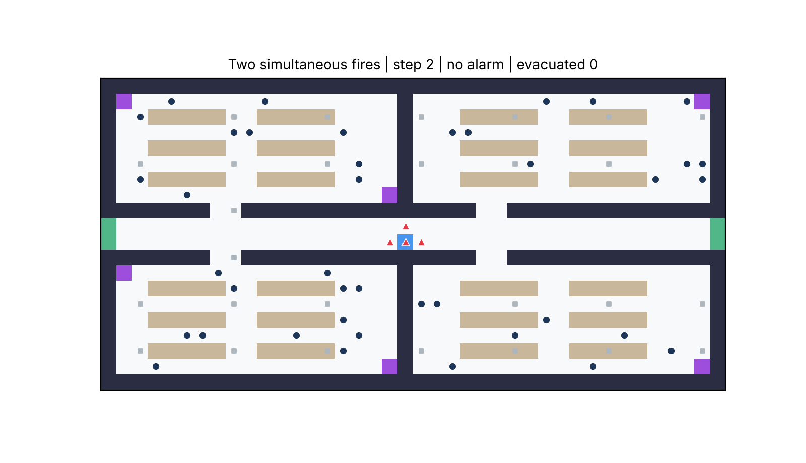

# Lab Incident Response – an Adaptive Multi-Agent Model

Agent-Based Adaptive Modelling · Assignment 2 · Python / **Mesa 3.5**

A fire starts at a chemical cabinet on a university lab floor. Smoke detectors
feed an alarm panel and a control room; responders with limited extinguishers
fight the fire using **beliefs** built from their own vision and from
**messages over an unreliable channel**; **heterogeneous occupants** evacuate.
We compare four coordination mechanisms, including the **Contract Net
Protocol**, and responders that **learn** their strategy with SMDP Q-learning.
Full model description in [ODD.md](ODD.md) (ODD protocol).



## Run it

Linux / macOS:

```bash
python -m venv .venv && source .venv/bin/activate
pip install -r requirements.txt
```

Windows (PowerShell, one command per line):

```powershell
python -m venv .venv
Set-ExecutionPolicy -Scope Process Bypass
.venv\Scripts\Activate.ps1
pip install -r requirements.txt
```

Then:

```bash

python run_gui.py                                  # live simulator → http://127.0.0.1:8090
python run_experiments.py --runs 30 --jobs 2       # E1–E4, statistics, plots   (~10 min)
python sensitivity.py --n 64 --jobs 2              # Sobol analysis            (~15 min)
python train_qlearning.py --episodes 1500          # re-train the Q-table      (~20 min)
python render_run.py --preset two_fires            # GIF + frames for slides
python -m unittest -v                              # 15 tests
```

## Architecture

| File | Contents |
|---|---|
| `environment.py` | Floor plan, fuel / fire / smoke fields, BFS path planning (cached), fire clusters |
| `messaging.py` | FIPA-style performatives, `MessageBus` (latency, loss), `BeliefMap` |
| `agents.py` | `SmokeDetector`, `Coordinator` (greedy dispatcher / Contract Net manager), `Responder` (beliefs, reflexes, options), `Occupant` |
| `policies.py` | Options, state encoding, `RulePolicy`, `QLearningPolicy` (SMDP Q-learning) |
| `model.py` | `LabIncidentModel`: scheduling, team reward, data collection |
| `simulation_config.py` | GUI presets and the experiment design E1–E4 |
| `train_qlearning.py` | Training, validation-based model selection, learning curve |
| `run_experiments.py` | 30 paired replicates per configuration, Wilcoxon + Holm, effect sizes, bootstrap CIs |
| `sensitivity.py` | Sobol indices (SALib, Saltelli sampling, common-random-number replicates) |
| `run_gui.py`, `index.html`, `app.js`, `style.css` | Browser GUI; all rules run in Python |
| `policies/q_table.json` | Trained Q-table used by the `learned` policy |
| `results/`, `plots/` | All outputs below |

## The model in short

- **Environment.** 40 × 20 cells: four labs with benches and chemical cabinets,
  a corridor, four exit cells, one extinguisher station. Fire spreads to the
  4 neighbours with probability ∝ intensity × fuel; smoke diffuses through air
  (not walls) faster than fire spreads.
- **Detectors** sense smoke or flames and can miss (reliability 0.9). The
  panel sounds the alarm after `alarm_delay` steps.
- **Coordination modes.** `none` (own eyes only) · `peer` (responders broadcast
  observations) · `central_greedy` (control room sends each free responder to
  the nearest believed fire, from *reported* positions) · `contract_net`
  (fire clusters and suspect detector zones are auctioned: CFP → PROPOSE/REFUSE
  → ACCEPT/REJECT → DONE/FAILURE, with timeouts).
- **Responders** (BDI-like): beliefs = fire map; two reflexes (shoot fire in
  reach, refill when empty); otherwise they commit for up to 4 steps to one of
  five **options**: follow task, nearest fire, fire front, explore smoke, refill early.
- **Learning.** Shared tabular SMDP Q-learning over the options, 288 states,
  team reward + individual reward for fire put out; 1500 training incidents
  with random mode and number of fires; best snapshot chosen on separate
  validation seeds.
- **Occupants.** Lognormal pre-movement delay, herding (react when two
  neighbours run), 40 % only know the west exits, health loss from smoke/fire,
  queueing at doors, counter-flow swaps with responders.

## Experimental design

Every configuration runs on the **same 30 seeds (1000–1029)** – common random
numbers – so each pair of configurations faces identical fires and occupants.
Comparisons use the **Wilcoxon signed-rank test** on the paired differences,
**Holm–Bonferroni** correction within each experiment and outcome, the
**matched-pairs rank-biserial correlation r** as effect size (−1…1) and a
**bootstrap 95 % CI** of the mean difference. Full tables: `results/stats.csv`.

## Results (means of 30 paired runs)

### E1 – Coordination mechanism

| Mechanism | 1 fire: burned | containment | response | 2 fires: burned | contained | messages |
|---|---:|---:|---:|---:|---:|---:|
| No communication | 67.4 | 149.1 | 35.5 | 196.2 | 87 % | 0 |
| Peer-to-peer | 58.7 | 131.2 | 35.3 | 184.3 | 87 % | 1790 |
| Greedy dispatcher | **8.4** | **39.7** | **18.9** | **67.2** | **100 %** | 1323 |
| Contract Net | 31.3 | 76.5 | 21.6 | 100.6 | 93 % | 1932 |

(burned = cells; containment and response = steps; response = alarm → first shot.)

- Both centralized mechanisms beat no communication (burned area, r = −1.00 and
  −0.87 with 1 fire, p_Holm ≤ 0.001). The gain comes from **detection**: the
  control room hears the detectors, so responders start fighting the fire 11–17 steps
  earlier.
- Peer-to-peer sharing barely helps (2 fires: n.s.): responders can only share
  what one of them has already found.
- **The simpler greedy dispatcher beats the Contract Net** (2 fires: 67 vs 101
  cells, r = 0.79, p_Holm = 0.002). Negotiation costs time (CFP → bids → award
  takes 3 message delays) and contracts commit responders to one cluster, while
  the dispatcher re-plans every step. More sophisticated ≠ better.

### E2 – Message loss

| | loss 0 % | 20 % | 50 % |
|---|---:|---:|---:|
| Greedy dispatcher, burned | 8.4 | 20.5 | 26.9 |
| Contract Net, burned | 31.3 | 43.0 | 53.7 |

Both degrade significantly (p_Holm ≤ 0.011) but **gracefully**: even with half
of the messages lost every fire is contained, thanks to timeouts, periodic
check-ins and the responders' own perception. Contract Net's response time
grows with loss (21.6 → 25.6 steps, p_Holm < 0.001): lost bids and awards
must be re-auctioned.

### E3 – Learning (2 fires)

| Mode | Rule policy | Learned policy | r | p_Holm |
|---|---:|---:|---:|---:|
| No communication | 196.2 | 177.1 | −0.31 | 0.47 |
| Peer-to-peer | 184.3 | 179.6 | −0.16 | 0.92 |
| Contract Net | 100.6 | 108.2 | 0.00 | 0.99 |

The learned policy is **as good as the hand-written rules but not
significantly better** on unseen test incidents. The learning curve
(`plots/learning_curve.png`) shows why: the validation score oscillates
because the team reward is very noisy (where the fire starts dominates the
outcome) and 288 coarse states hide what matters. It mostly rediscovered the
rule ("follow the task" is the preferred option in most visited states).
Improvements: richer state (fire front direction, teammates' charges),
function approximation, centralized-critic multi-agent RL.

### E4 – Resources and alarm delay (Contract Net)

| | burned | evacuation time | occupant exposure |
|---|---:|---:|---:|
| 2 responders | 62.3 | 54.0 | 0.051 |
| **4 responders** (reference) | 31.3 | 53.6 | 0.078 |
| 8 responders | 10.0 | 53.7 | 0.066 |
| alarm delay 10 | 36.2 | 61.9 | 0.108 |
| alarm delay 20 | 52.3 | 73.0 | 0.224 |
| alarm delay 30 | 77.8 | 82.4 | **0.374** |

Team size drives the burned area; the **alarm delay drives the danger to
people**: 30 steps of delay multiply the occupants' smoke exposure by ~5
(r = 0.83, p_Holm < 0.001).

### Global sensitivity (Sobol, `plots/sobol.png`)

512 parameter samples × 4 common-random-number replicates, Contract Net.

| Parameter | Burned area ST | Exposure ST |
|---|---:|---:|
| alarm_delay | **0.49** | **0.97** |
| n_responders | 0.41 | 0.23 |
| p_spread | 0.39 | 0.03 |
| detector_reliability | 0.17 | 0.09 |
| extinguisher_charges | 0.12 | 0.00 |
| comm_loss | 0.11 | 0.01 |

Occupant safety depends almost only on **how fast the alarm sounds**; the
burned area depends on alarm delay, team size and how flammable the lab is.
Communication loss and extinguisher size matter much less. (Confidence
intervals are wide with N = 64; the ranking is the robust result.)

## Methodological notes

- Seeds: training ≥ 100000, validation 5000–5011, experiments 1000–1029,
  Sobol 30000–30003 – no overlap, so E3 is out-of-sample.
- Running the same configuration and seed twice gives identical trajectories
  (tested). Results can differ across Python / Mesa / NumPy versions.
- Exposure is a heavy-tailed outcome (rare incapacitations); burned area and
  containment time are the more stable measures.

## Limitations

Illustrative parameters, not calibrated to real fire or evacuation data; 2D
floor; no doors that close or ventilation system; responders are never hurt;
detectors see flames through the line of sight of the room only; the learned
policy uses a small tabular state space.
